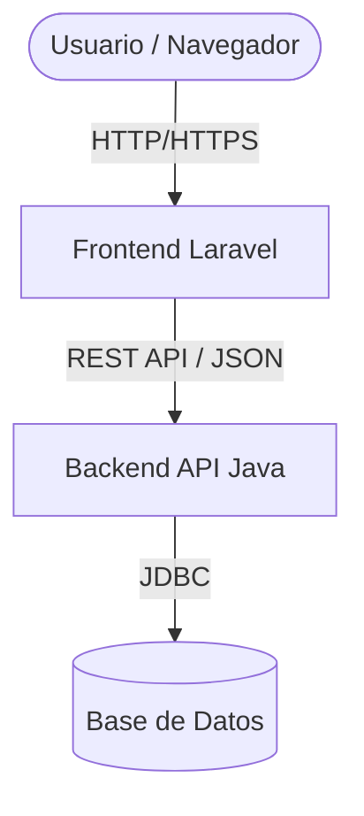

# Arquitectura del Sistema - SICAPS Web

## 1. Patrón Arquitectónico
SICAPS Web implementa una **Arquitectura en Capas y Orientada a Servicios**. Se separan las responsabilidades de presentación (Frontend) y lógica de negocio/persistencia (Backend).

## 2. Componentes

### 2.1. Frontend (Laravel / PHP)
Actúa como cliente de la API Java.
- **Framework:** Laravel 11 (PHP 8.2+).
- **Rol:** Renderizado de vistas (Blade), control de sesiones de usuario web, ruteo de interfaz.
- **Comunicación:** Usa `GuzzleHttp` para realizar peticiones REST al backend.

### 2.2. Backend (Spring Boot / Java)
Actúa como API REST centralizada y es el dueño de la lógica de negocio.
- **Framework:** Spring Boot 3.x (Java 17).
- **Rol:** Controladores REST (`@RestController`), servicios con lógica de negocio (`@Service`), y persistencia (`@Repository`).
- **Seguridad:** Spring Security maneja la autenticación (JWT o sesiones basadas en tokens para la comunicación con Laravel).

### 2.3. Base de Datos (PostgreSQL / Supabase)
Única fuente de verdad de la información clínica y administrativa.
- **Motor:** PostgreSQL (local en Docker o gestionado en Supabase).
- **Acceso:** Realizado exclusivamente a través de Spring Data JPA (Hibernate) desde el backend. Laravel no lee directamente las tablas maestras.

## 3. Diagrama (Conceptual)

