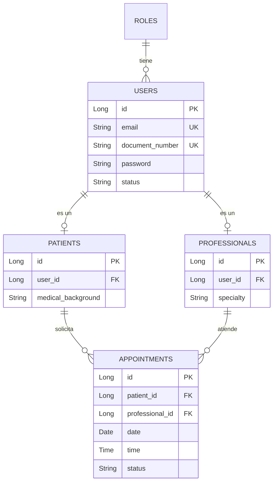

# Base de Datos - SICAPS Web

## Modelo Relacional

La base de datos relacional utiliza **PostgreSQL** y se estructura de la siguiente manera, garantizando la integridad referencial y las reglas del negocio:

### Entidades Principales

1. **`roles`**
   - `id` (PK)
   - `name` (UNIQUE)
   - `description`

2. **`users`**
   - `id` (PK)
   - `name`, `last_name`, `document_type`
   - `document_number` (UNIQUE)
   - `email` (UNIQUE)
   - `role_id` (FK -> `roles.id`)
   - `password`, `status`

3. **`patients`**
   - `id` (PK)
   - `user_id` (FK -> `users.id`, UNIQUE)
   - `emergency_contact_name`, `emergency_contact_phone`
   - `medical_background`, `psychological_background`

4. **`professionals`**
   - `id` (PK)
   - `user_id` (FK -> `users.id`, UNIQUE)
   - `specialty`
   - `medical_registration_number` (UNIQUE)

5. **`appointments`** (Citas)
   - `id` (PK)
   - `patient_id` (FK -> `patients.id`)
   - `professional_id` (FK -> `professionals.id`)
   - `date`, `time`, `duration_minutes`
   - `reason`, `status`, `observations`

### Diagrama Entidad-Relación (ER) Conceptual

